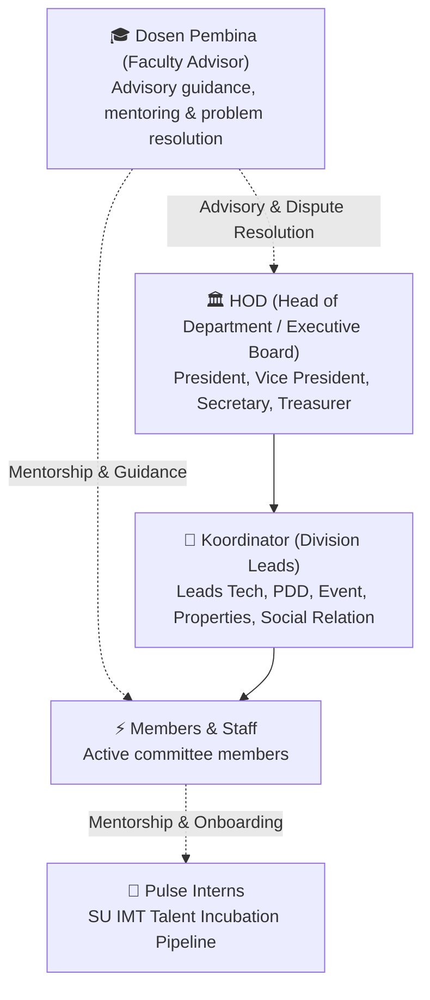
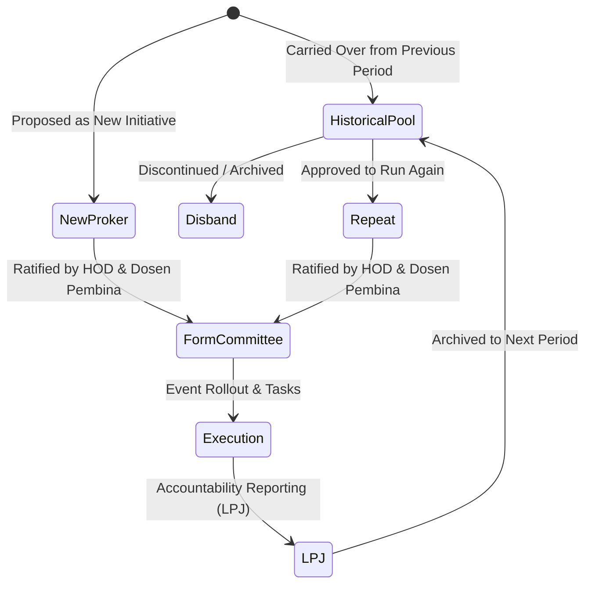
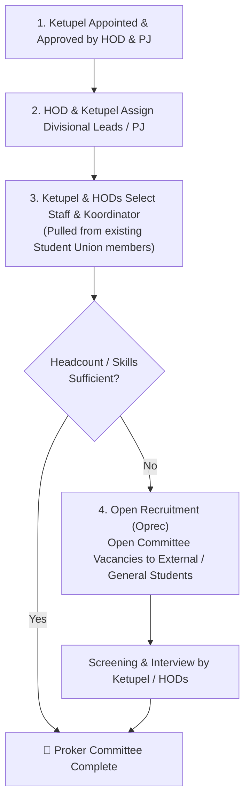
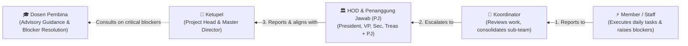
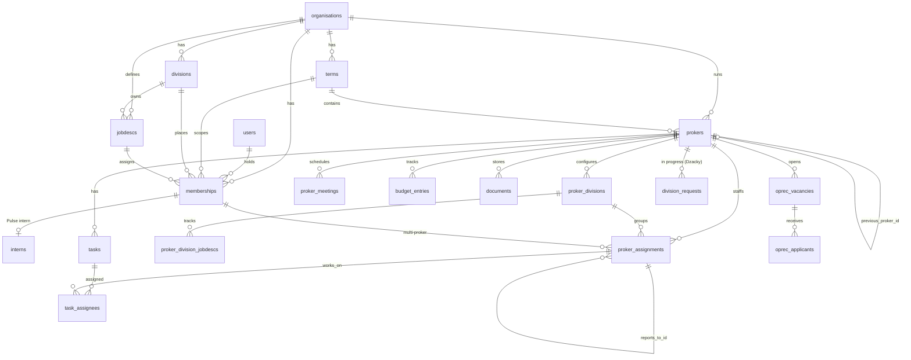

# 🏛️ Himpun — Student Union & Campus Organisation ERP

[](https://laravel.com)
[](https://php.net)
[](https://tailwindcss.com)
[](LICENSE)
[](https://github.com/Sean-230/Himpun-Cloudcom)

**Himpun** (derived from *Himpunan* / *menghimpun*) is a specialized ERP platform purpose-built for university student unions (*Himpunan Mahasiswa*), student councils, mentoring boards, and student activity units (UKMs). 

It bridges the gap between chaotic spreadsheets and rigid corporate ERPs by modeling how student-led committees actually operate: faculty advisory guidance, executive leadership (HOD), standing operational divisions, dynamic work programs (Proker), event-specific oversight (Penanggung Jawab & Ketupel), open recruitment drives, and talent incubation pipelines.

> [!NOTE]
> **Status:** a clickable prototype. The screens (dashboards, proker list and detail, create form, division requests, role-based views) run on built-in dummy data (`app/Support/DummyData.php`). There is no real login and nothing is saved yet. Making it real is the current work, split between three people (see the Team & Work Split section below).

---

## 👥 How the Organization Works

Student organizations operate with faculty mentorship, top executive leadership (HOD), and specialized operational divisions.

### 1. Hierarchy & Standing Leadership Tiers



- **Dosen Pembina (Faculty Advisor)**: The supervising faculty lecturer with persistent oversight across **all periods** (`25/26`, `26/27`, `27/28`, ...). Has a dedicated **2-Tab Dashboard**:
  - **Tab 1 — Periode:** Create/manage periods, customize divisions & HOD slots per period (add/rename/remove divisions freely), add or remove students per division, and carry over returning members across periods.
  - **Tab 2 — Daftar Mahasiswa:** Master student directory across periods to view each student's full summary (memberships, jobdescs, active/past prokers & roles, workload), **reset password** (resets activation so the student sets a new password via `/register`), and **smart delete** (hard delete if no proker history; soft delete if they have historical proker records).
- **First-Time Student Activation (`/register`)**: When Dosen Pembina adds a new student (`Nama`, `NIM`, `Email`), the account starts unactivated (`password = null`). On first login, the student clicks **Register**, enters `Nama`, `NIM`, `Email`, `Password`, and `Confirm Password` to claim their account. Returning members from an earlier period reuse their existing account automatically.
- **HOD (Head of Department / Executive Board)**: The standing executive board steering overall union governance — defaults to **6 flexible slots** per period (customizable by Dosen Pembina):
  - 👑 **President** (Ketua Himpunan)
  - 🤝 **Vice President** (Wakil Ketua)
  - 💰 **Bendahara** (Treasurer) & **Asisten Bendahara** (Assistant Treasurer)
  - 📝 **Secretary** (Sekretaris) & **Asisten Secretary** (Assistant Secretary)
- **Koordinator**: Divisional coordinators leading standing operational teams (default baseline: Tech, PDD Design, PDD Dokum, Event, Social Relation, Properties — fully customizable per period by Dosen Pembina).
- **Members / Staff**: Core committee members executing operational job descriptions (jobdescs) and daily responsibilities (headcount per division is flexible).
- **Pulse Program**: An exclusive internship and talent pipeline for Student Union IMT, introducing junior student cohorts to organizational culture, committee responsibilities, and hands-on event execution before full induction.

---

### 2. Standing Divisions (SU IMT Baseline)

Himpun's initial phase models the standing structure of **Student Union IMT** (Informatika & Information Technology):

| Division | Function & Core Responsibilities |
|---|---|
| 💻 **Tech** | Internal tooling, web development, digital platforms, IT infrastructure, and technical execution. |
| 🎨 **PDD Design** | Visual branding, social media assets, graphic design guidelines, UI/UX, and creative assets. |
| 📸 **PDD Dokum** | Photography, aftermovie videography, media documentation, and archive management. |
| 🎪 **Event** | Concept ideation, rundowns, talent management, guest speakers, and on-the-ground event operations. |
| 🤝 **Social Relation** | External partnerships, public relations, university communications, sponsorship liaisons, and community outreach. |
| 📦 **Properties** | Logistics, equipment procurement, venue bookings, stage setup, and physical inventory management. |

---

## 🎯 How Work Programs (Proker) Work

Beyond standing daily operations, the lifeblood of a student union lies in **Work Programs (Program Kerja / Proker)** — large events, workshops, hackathons, and campaigns. Each Proker operates with its own lifecycle, project-based committee structure, and staffing pipeline.

### 1. Proker Lifecycle



- **Repeat (Lanjutan)**: Flagship annual or recurring programs inherited from past periods (e.g., orientation events, annual exhibitions).
- **Disband / Archive**: Programs that are officially retired, completed, or omitted for the current administrative year.
- **Create New (Baru)**: Fresh initiatives proposed and approved for the current term.

---

### 2. Proker Committee Structure (Panitia Proker)

Every Proker is headed by a **Ketua Pelaksana (Ketupel)** who sets and customizes the divisions required for that specific event.

In an event, the **HOD** oversight body remains the same (President, Vice President, Secretary, Treasurer), but is bolstered with an appointed **Penanggung Jawab (PJ)**:

| Proker Leadership / Division | Role in the Project |
|---|---|
| 🎓 **Dosen Pembina** | Faculty advisory oversight, institutional validation, and ultimate escalation resolver. |
| 👑 **Ketupel (Ketua Pelaksana)** | Project Head responsible for overall event planning, execution, timeline, budget, and coordination. |
| 🏛️ **HOD + Penanggung Jawab (PJ)** | Executive oversight body consisting of the HOD (President, VP, Secretary, Treasurer) plus a designated **Penanggung Jawab (PJ)** acting as executive guardian for the event. |
| 🎯 **Divisional Koordinators** | Field leaders heading each event division (Event, Inventory, People Relation, Marketing, PDD Dokum, PDD Design, Tech). |
| ⚡ **Committee Members** | Active staff executing divisional work packages and tasks. |

#### Typical Proker Divisions:
- 🎪 **Event**: Master rundown, concept design, speaker/performer briefs, stage management.
- 📦 **Inventory (Properties)**: Venue booking, logistics, sound & lighting gear, stage construction, procurement.
- 🤝 **People Relation**: Public relations, official university approvals, stakeholder coordination, guest welcoming.
- 📢 **Marketing**: Promotion campaigns, ticket sales, media partners, and commercial sponsorships.
- 📸 **PDD Dokum**: Live photo/video coverage, aftermovie production, and press archiving.
- 🎨 **PDD Design**: Event logo, posters, social media banners, tickets, name tags, and stage backdrop.
- 💻 **Tech**: Event landing page, attendee check-in/ticketing QR scanner, online registration forms.

---

### 3. Staffing & Recruitment Workflow

Proker committee staffing follows a defined delegation funnel:



1. **Ketupel Designation**: Appointed and ratified by the HOD and Dosen Pembina.
2. **HOD & PJ Oversight Assignment**: The executive HOD (President, VP, Secretary, Treasurer) assigns an executive **Penanggung Jawab (PJ)** for the event.
3. **Internal Member Assignment**: The Ketupel, HOD, and PJ collaboratively draft and assign **Koordinators** and **Members** from the existing Student Union roster.
4. **Open Recruitment (Oprec / Committee Vacancy)**: If additional headcount or specialized skills are required beyond the active union roster, the Proker opens an **Open Recruitment** campaign allowing general campus students to apply.

---

### 4. Multi-Role & Cross-Proker Assignments (Workload Matrix)

In a student union, members are rarely confined to a single static responsibility:

> [!TIP]
> **Flexible Many-to-Many Assignments**: A single committee member can simultaneously hold **multiple job roles across multiple Prokers** (e.g. serving as *Tech Koordinator* in an Annual Hackathon, *PDD Design Staff* in Orientation Camp, while maintaining their standing role in the union).

Himpun accommodates this through dynamic project scoping:
- **Cross-Proker Capacity Overview**: Real-time dashboard showing every member’s active assignments across all ongoing events to balance workloads, detect timeline clashes, and prevent burnout.
- **Context-Switching Dashboard**: Members can seamlessly switch active Proker workspaces in the UI to view relevant task boards, timelines, and communications for each project.
- **Per-Proker Granular Permissions**: Role permissions are scoped per Proker — a student can have elevated coordinator permissions in Proker A, while holding standard member rights in Proker B.

---

### 5. Strict Communication Line (Alur Komunikasi)

To prevent confusion and operational bottlenecks, every Proker enforces a strictly disciplined communication and reporting chain:

$$\mathbf{Ketupel \longleftarrow HOD \ (+ \ PJ) \longleftarrow Koordinator \longleftarrow Member}$$



- **Strict Hierarchical Escalation**: Members communicate exclusively with their **Koordinator**. Coordinators consolidate updates and consult the **HOD (+ PJ)**. The HOD/PJ directly coordinates with the **Ketupel**.
- **Role of Dosen Pembina**: If unresolvable obstacles or organizational deadlock arise, the Ketupel and HOD consult the **Dosen Pembina** for guidance and resolution.
- **No Bypassing**: Team members do not skip levels directly to the Ketupel or Dosen Pembina, keeping operational focus clear and structured.
- **In-App ERP Enforcement**: Himpun mirrors this rule in task review gates, approval chains, and ticket escalation (e.g. task sign-offs flow: Member $\rightarrow$ Koordinator $\rightarrow$ HOD/PJ $\rightarrow$ Ketupel).

---

## 👨‍💻 Team & Work Split

Himpun is built by three people. After BB's first milestone merged (`7ed1137`), the **remaining work** was rebalanced to **18 points each** so everyone works in parallel with zero file conflicts. Full contracts, migration ranges, and the file-ownership map are in [`docs/pembagian-tugas.md`](docs/pembagian-tugas.md).

### 1. BB — Access, Dosen Pembina Dashboard, `/register` & Dashboards *(20 pts remaining)*
- **Already merged on `main`:**
  - [x] Organisation, Term, Division, Membership & Jobdesc models + `OrganisationSeeder` (42 members)
  - [x] Login & Logout (`/login`, `/logout`)
  - [x] Members Directory (`/anggota`) and Divisions & Jobdesc CRUD (`/divisi`, `/jobdesc`)
  - [x] Admin Console moved into `layouts.app` with `role:hod`
- **Remaining features:**
  - [ ] **Auth, `/register` Activation & Roles (4 pts):** Protect routes with `auth`, build `/register` (`Nama`, `NIM`, `Email`, `Password`, `Confirm Password`) to claim pre-registered accounts, separate `role = 'dosen'` (via `organisations.advisor_user_id`), resolve per-proker roles (`pj`, `koor`, `ketupel`) from `proker_assignments`
  - [ ] **Account Menu, Local Switcher & Security (3 pts):** Sign In / Sign Out in header, 404 on `/peran` outside `local`, `throttle:5,1` on `/login`, `SESSION_SECURE_COOKIE`, HSTS/CSP headers, Postgres case-insensitive `/anggota` search, org-scoped edits, delete `adminView.blade.php`
  - [ ] **Auth & Master-Data Tests (3 pts):** `ActsAsRole` helper, fix the 17 failing PHPUnit tests on `main`, add tests for `/login`, `/register`, `/anggota`, `/divisi`, `/jobdesc`, and Dosen Pembina guards
  - [ ] **Dosen Pembina 2-Tab Dashboard (6 pts):**
    - *Tab 1 (Periode):* List/create periods (`25/26`, `26/27`, `27/28`), flexible default 6 HOD slots + custom divisions per period, add/remove students (new pre-register or carry-over from past term)
    - *Tab 2 (Daftar Mahasiswa):* Master directory across periods with student detail summary (jobdescs + active/past prokers via `ProkerAccess::summaryForUser()`), **Reset Password** (clears `password` & `activated_at` so student re-registers), and **Smart Delete** (hard delete if no proker history; soft delete if has history)
  - [ ] **Live HOD & PJ Dashboards (4 pts):** Move `/dashboard` off `DummyData`, fix empty-DB divide-by-zero & past Hari-H labels, fold/retire duplicate static `/admin`, add dashboard tests

### 2. Sean — Database Overhaul, Proker Creation, Supabase, AI & Delivery *(16 pts remaining)*
- **Done on `Sean` branch (verified live on Supabase `himpun` schema):**
  - [x] **Proker & Dosen Pembina Database Overhaul (6 pts):**
    - Migrations `2026_12_01_200000`–`200200` (`proker_division_jobdescs`, `proker_meetings`, `prokers.location`, `UNIQUE(proker_id, membership_id)`, `UNIQUE(proker_id, name)`, `users.password` nullable + `activated_at` + `deleted_at`, `organisations.advisor_user_id`, term-scoped `divisions.term_id` & `jobdescs.term_id`, Postgres FK indexes)
    - Models (`Proker`, `ProkerDivision`, `ProkerAssignment`, `ProkerDivisionJobdesc`, `ProkerMeeting`) + `ProkerStatus` enum + updated `User`/`Organisation`/`Term`/`Division`/`Jobdesc` + `ProkerSchemaTest` (6/6 passing)
    - Supabase PostgreSQL (`lhnoaslcoadicdgrmesd`, private schema `himpun`) live, migrated (27 tables), and seeded (42 users)
- **Remaining features:**
  - [ ] **Create Proker Backend (4 pts):** `POST /proker` controller & Form Request in a DB transaction (1 person 1 role, Ketupel ≠ PJ, valid jobdescs, Hari-H ≥ today, repeat link)
  - [ ] **Create Proker Form & Seeder (3 pts):** Feed real DB members & past prokers into `/proker/baru`, show server 422 errors, redirect to saved proker, build `ProkerSeeder`
  - [ ] **Create-Flow Tests & WIB Timezone (2 pts):** PHP feature tests for every rule, keep `proker-form.test.mjs` green, set `Asia/Jakarta` timezone with `Carbon::setTestNow`
  - [ ] **CI/CD Overhaul for Supabase/Postgres (3 pts):** Fix `deploy.yaml` (`postgres:16`, `pgsql` ext, `npm ci`, JS tests + Pint, `contents: read`, SSH key, zero-downtime swap)
  - [ ] **AI Integration (3 pts):** Build and integrate Himpun's AI feature(s) (scope & provider to be finalized)
  - [ ] **Docs & Final Cleanup (1 pt):** `docs/DEPLOY.md`, keep `README.md` current, delete `welcome.blade.php`, and closing PR deleting `DummyData.php`

### 3. Dzacky — Division Requests, Proker List & Proker Detail *(20 pts remaining)*
- **Drafted on `dzaky` branch:**
  - [x] `division_requests` migration, `DivisionRequest` model, policy & Form Requests
- **Remaining features:**
  - [ ] **Division Requests Backend (3 pts):** Wire controller & routes to DB, enforce sender/receiver rules & valid status order, add `DivisionRequest::pendingCountFor()`
  - [ ] **Division Requests UI Fixes (2 pts):** Fix XSS by replacing `'{{ old(...) }}'` with `@js(...)` in `request/index.blade.php`, drop unused variables, keyboard-friendly tabs
  - [ ] **Division Requests Tests & Seeder (2 pts):** Feature tests for every rule + `RequestSeeder`
  - [ ] **Live Proker List & `ProkerAccess` (5 pts):** Move proker visibility logic to DB (`App\Support\ProkerAccess`), add `ProkerAccess::summaryForUser(User $user)` (for Dosen Pembina's Tab 2 student detail), and wire `/proker` using `ProkerStatus` enum
  - [ ] **Live Proker Detail (5 pts):** Move `/proker/{id}` off `DummyData` and save ticked/added/removed jobdescs & weekly meetings (HOD only, 403 for others)
  - [ ] **Proker List & Detail Tests (3 pts):** PHP feature tests for `/proker`, `/proker/{id}`, `summaryForUser()` & write guards + keep `proker-detail.test.mjs` green

**Route jobdesc:**
- **BB:** `routes/auth.php`, `routes/dosen.php`, `routes/dashboard.php` (`/`, `/login`, `/logout`, `/register`, `/peran`, `/admin`, `/anggota`, `/divisi`, `/jobdesc`, `/dosen/*`, `/dashboard`)
- **Sean:** `routes/proker_write.php`, `routes/ai.php` (`/proker/baru`, `POST /proker`, `/ai/*`)
- **Dzacky:** `routes/proker_read.php`, `routes/request.php` (`/proker`, `/proker/{id}`, jobdesc & meeting endpoints, `/request-divisi*`)

**Working agreement (details in the doc):**

1. Edit only the files you own. Need a change elsewhere? Open a tiny PR to `main` first.
2. Never edit an old migration; add new ones (timestamp ranges: BB `2026_12_01_1*`, Sean `2026_12_01_2*`, Dzacky `2026_12_01_3*`).
3. No repo-wide formatting or dependency updates. Only BB changes `composer.*` and `package*.json`.
4. `DummyData.php` is frozen; Sean deletes it in the closing PR (2.7).
5. Rebase on `main` daily, keep PRs small, and make `php artisan test`, `node --test "tests/js/*.test.mjs"`, and `vendor/bin/pint --test <your files>` pass before opening one.

---

## 📊 Feature Status & Roadmap

| Module / Feature Area | Status | Owner |
|---|---|:-:|
| **Foundation, Supabase Postgres & CI/CD** (Laravel 13, GitHub Actions to CloudPanel) | 🟡 Works on MySQL/SQLite; moving to Supabase & hardening CI | Sean |
| **Authentication & RBAC** (`/login`, `/logout`, `Access::me()`) | 🟡 Login exists; needs `auth` guards, per-proker roles, local-only `/peran`, security headers & test fixes | BB |
| **Organisation, members & divisions** (`/anggota`, `/divisi`, `/jobdesc`, `OrganisationSeeder`) | 🟢 Merged on `main`; needs Postgres case-insensitive search, org-scoping & tests | BB |
| **Admin console** (`/admin`) | 🟡 Integrated in `layouts.app` with `role:hod`, still hardcoded JS data | BB |
| **Dashboards** (HOD & PJ views) | 🟡 Prototype on dummy data | BB |
| **Proker models, migrations & `ProkerStatus`** | 🟢 Built on `Sean` branch (ready for PR 2.1) | Sean |
| **Proker create** (`POST /proker`, form wiring, `ProkerSeeder`) | 🟡 Prototype: rules only in JavaScript, nothing saved | Sean |
| **Jobdesc targets & weekly meetings** | 🟡 Tables & models built on `Sean`; screens still on dummy data | Sean (tables), Dzacky (screens) |
| **Proker list & detail** (`/proker`, `/proker/{id}`) | 🟡 Prototype on dummy data | Dzacky |
| **Division requests** (koordinator to koordinator) | 🟡 Schema/model/policy drafted on `dzaky`; UI still on session | Dzacky |
| **AI integration** | ⚪ Planned | Sean |
| **Oprec, Pulse, Approvals, Budget, Documents & Tasks** | ⚪ Schema migrated, features not assigned yet | – |

---

## 🗄️ Database Structure

Himpun has **19 domain tables** (+ 7 Laravel system tables) migrated on `Sean` (17 on `main` + 2 added in PR 2.1), plus **1 planned table** (`division_requests` in progress on `dzaky`).



### ✅ Already Added (Migrated)

| Table | Key Columns & Constraints | Model Status | Owner (Jobdesc) |
|---|---|---|---|
| **`users`** | `id`, `name`, `email` (unique), `nim` (unique, nullable), `phone` (nullable), `password` (nullable until `/register`), `activated_at`?, `deleted_at`? (soft delete) | ✅ `User` | **BB** *(auth & `/register` 1.1–1.4)* |
| **`organisations`** | `id`, `name`, `slug` (unique), `type` (`himpunan`/`bem`/`mentoring`/`bpm`/`ukm`), `faculty`, `advisor_user_id`? (FK → `users`, Dosen Pembina) | ✅ `Organisation` | **BB** *(Dosen Pembina 1.1 / 1.4)* |
| **`terms`** | `id`, `organisation_id` (FK), `name` (`25/26`, `26/27`, ...), `starts_on`, `ends_on`, `is_active` | ✅ `Term` | **BB** *(Tab 1 Periode 1.4)* |
| **`divisions`** | `id`, `organisation_id` (FK), `term_id` (FK), `name` · `UNIQUE(organisation_id, term_id, name)` | ✅ `Division` | **BB** *(per-term divisions 1.4)* |
| **`jobdescs`** | `id`, `organisation_id` (FK), `term_id` (FK), `division_id`? (null for HOD; default 6 HOD titles), `title`, `description`, `level` | ✅ `Jobdesc` | **BB** *(per-term HOD/divisi 1.4)* |
| **`memberships`** | `id`, `user_id`, `organisation_id`, `term_id`, `division_id`?, `jobdesc_id`?, `status` · `UNIQUE(user_id, organisation_id, term_id)` | ✅ `Membership` | **BB** *(Tab 1 & Tab 2 1.4)* |
| **`interns`** | `id`, `membership_id` (unique FK), `mentor_membership_id` (FK), `cohort`, `score`, `status` | ⚪ No model yet | Unassigned *(Pulse)* |
| **`prokers`** | `id`, `organisation_id`, `term_id`, `previous_proker_id` (self-FK), `name`, `type` (`repeat`/`new`), `status` (`ProkerStatus`), `description`, `starts_on`, `ends_on`, `location` | ✅ `Proker` *(on `Sean`)* | **Sean** (2.1–2.4) |
| **`proker_divisions`** | `id`, `proker_id` (FK), `division_id` (nullable FK), `name` · `UNIQUE(proker_id, name)` | ✅ `ProkerDivision` *(on `Sean`)* | **Sean** (2.1–2.4) |
| **`proker_assignments`** | `id`, `proker_id` (FK), `membership_id` (FK), `proker_division_id` (nullable FK), `role`, `reports_to_id` (self-FK) · `UNIQUE(proker_id, membership_id)` | ✅ `ProkerAssignment` *(on `Sean`)* | **Sean** (2.1–2.4) |
| **`proker_division_jobdescs`** | `id`, `proker_division_id` (FK cascade), `title` (120), `days_before` (int, negative = after Hari-H), `done` (bool) | ✅ `ProkerDivisionJobdesc` *(on `Sean`)* | **Sean** (2.1) · *UI by Dzacky (3.5)* |
| **`proker_meetings`** | `id`, `proker_id` (FK cascade), `scope` (`pleno`/`koor`/`division`), `proker_division_id` (nullable FK), `weekday` (0–6), `starts_at` (time), `place` | ✅ `ProkerMeeting` *(on `Sean`)* | **Sean** (2.1) · *UI by Dzacky (3.5)* |
| **`budget_entries`** | `id`, `proker_id`, `proker_division_id`?, `kind` (`planned`/`actual`), `type` (`income`/`expense`), `category`, `description`, `amount`, `entry_date`, `receipt_path`, `recorded_by` | ⚪ No model yet | Unassigned *(Budget)* |
| **`oprec_vacancies`** | `id`, `proker_id`, `proker_division_id`?, `title`, `quota`, `requirements`, `opens_at`, `closes_at`, `status` | ⚪ No model yet | Unassigned *(Oprec)* |
| **`oprec_applicants`** | `id`, `oprec_vacancy_id`, `user_id`, `status`, `notes`, `proker_assignment_id`? · `UNIQUE(oprec_vacancy_id, user_id)` | ⚪ No model yet | Unassigned *(Oprec)* |
| **`tasks`** | `id`, `proker_id`, `proker_division_id`?, `created_by`?, `title`, `description`, `due_on`, `priority`, `status` | ⚪ No model yet | Unassigned *(Tasks)* |
| **`task_assignees`** | `task_id` (FK), `proker_assignment_id` (FK) · `PRIMARY(task_id, proker_assignment_id)` | ⚪ Pivot table | Unassigned *(Tasks)* |
| **`approvals`** | `id`, `approvable` (morphs), `step`, `required_role`, `status`, `acted_by`?, `acted_at`, `note` | ⚪ No model yet | Unassigned *(Approvals)* |
| **`documents`** | `id`, `proker_id`, `type` (`proposal`/`lpj`/`other`), `title`, `path`, `status`, `uploaded_by` | ⚪ No model yet | Unassigned *(Documents)* |

> **Laravel system tables (already migrated):** `password_reset_tokens`, `sessions`, `cache`, `cache_locks`, `jobs`, `job_batches`, `failed_jobs`, `migrations`.

### ⏳ Not Merged to `main` Yet

| Table | Planned Columns & Purpose | Status | Owner (Jobdesc) |
|---|---|---|---|
| **`division_requests`** *(new table)* | `id`, `proker_id`, `from_proker_division_id`, `to_proker_division_id`, `from_user_id`, `to_user_id`, `title` (150), `note`, `due_on`, `status` (`Menunggu`/`Diproses`/`Selesai`/`Ditolak`) | 🟡 Drafted on `dzaky` branch | **Dzacky** (3.1–3.3) |

---

## 🛠️ Stack & Tooling

- **Backend**: [Laravel 13.x](https://laravel.com)
- **Runtime**: PHP 8.4 (via [Laravel Herd](https://herd.laravel.com))
- **Database**: SQLite (local dev & unit tests) / **Supabase (PostgreSQL)** (production)
- **Frontend**: Blade, [Tailwind CSS v4](https://tailwindcss.com), [Alpine.js](https://alpinejs.dev), Vite, IBM Plex Sans
- **Tests**: PHPUnit (PHP) and `node --test` (JavaScript logic)
- **Deployment**: GitHub Actions builds and tests on every push to `main`, then ships to CloudPanel over SSH

---

## 🚀 Local Development Setup

### 1. Prerequisites
Ensure PHP 8.4 and Composer are available in your shell environment:

```bash
# Add Laravel Herd binaries to PATH (macOS)
export PATH="/Users/seantandjaja/Library/Application Support/Herd/bin:$PATH"

php -v
composer -V
```

### 2. Installation & Run

```bash
# 1. Clone repository
git clone https://github.com/Sean-230/Himpun-Cloudcom.git
cd Himpun-Cloudcom

# 2. Install dependencies
composer install
npm install

# 3. Setup environment & database
cp .env.example .env
php artisan key:generate
touch database/database.sqlite
php artisan migrate

# 4. Start the app (PHP server + Vite together)
composer run dev
# or separately: php artisan serve  and  npm run dev
```

### 3. Try the roles (demo)

Until real login exists, the top-right switcher chooses a role (HOD, PJ, Koordinator, Anggota) and who you are in it. Each role sees different pages: see `app/Support/Access.php` and `tests/Feature/RoleAccessTest.php`.

### 4. Run the tests

```bash
php artisan test
node --test "tests/js/*.test.mjs"
vendor/bin/pint --test   # code style
```

> Never commit `.env` (it is git-ignored). It holds your keys and database password.

---

## 📄 License
This project is open-source under the [MIT License](LICENSE).
