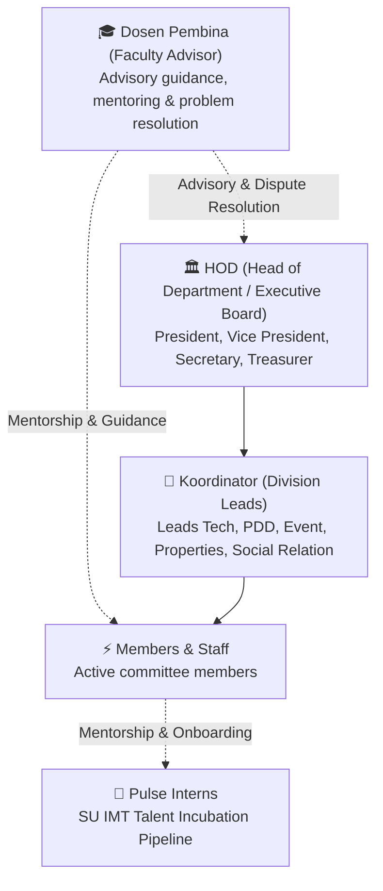
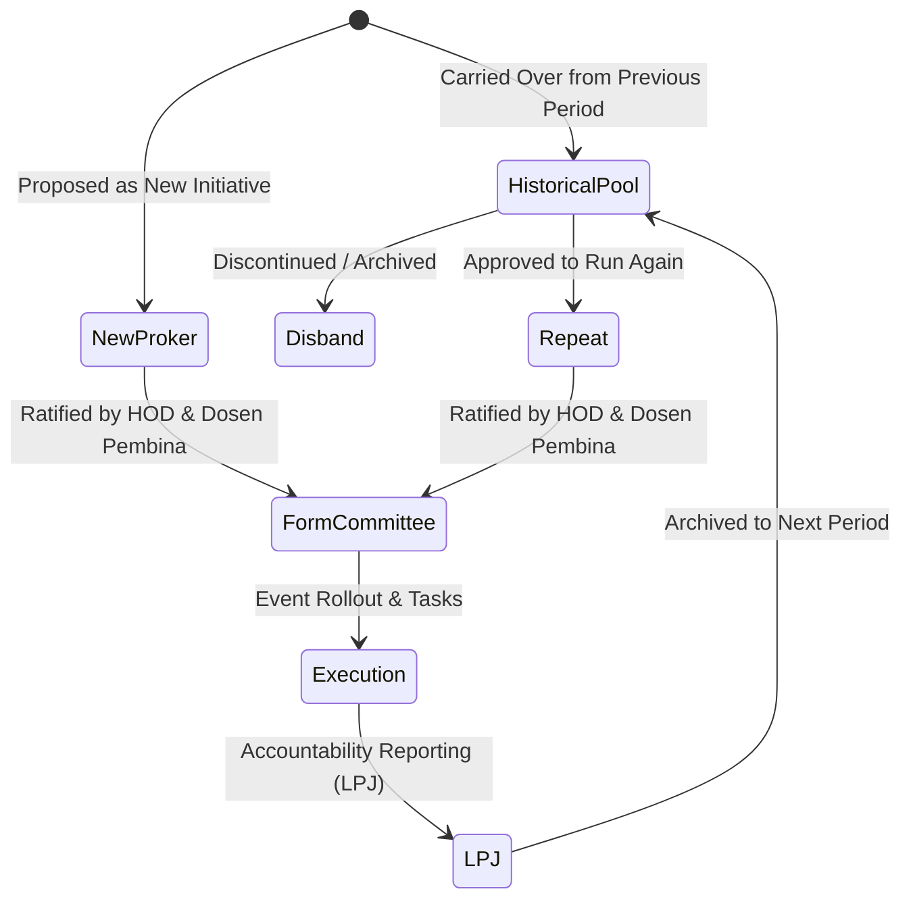
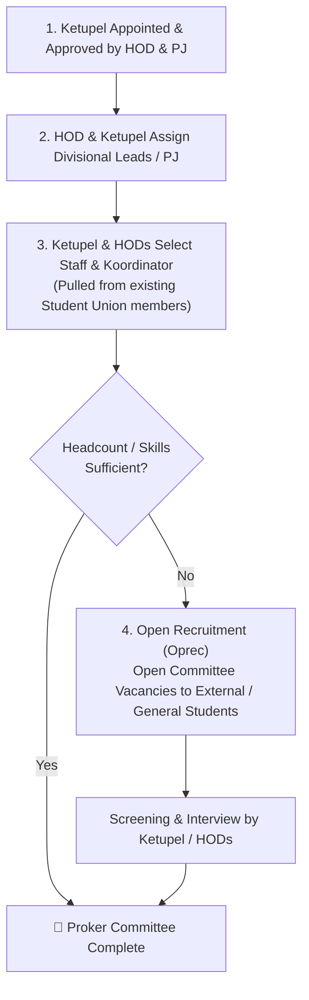
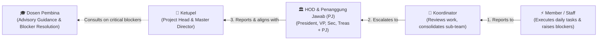
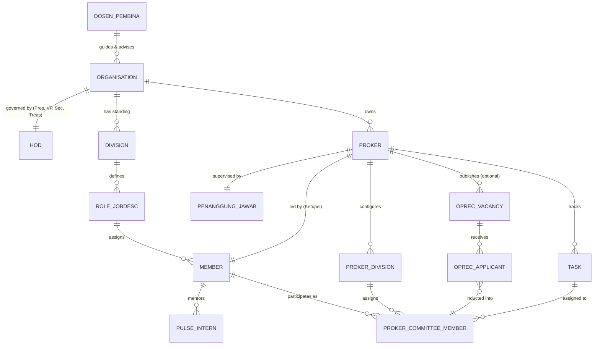

# 🏛️ Himpun — Student Union & Campus Organisation ERP

[](https://laravel.com)
[](https://php.net)
[](https://tailwindcss.com)
[](LICENSE)
[](https://github.com/Sean-230/Himpun-Cloudcom)

**Himpun** (derived from *Himpunan* / *menghimpun*) is a specialized ERP platform purpose-built for university student unions (*Himpunan Mahasiswa*), student councils, mentoring boards, and student activity units (UKMs). 

It bridges the gap between chaotic spreadsheets and rigid corporate ERPs by modeling how student-led committees actually operate: faculty advisory guidance, executive leadership (HOD), standing operational divisions, dynamic work programs (Proker), event-specific oversight (Penanggung Jawab & Ketupel), open recruitment drives, and talent incubation pipelines.

---

## 👥 How the Organization Works

Student organizations operate with faculty mentorship, top executive leadership (HOD), and specialized operational divisions.

### 1. Hierarchy & Standing Leadership Tiers



- **Dosen Pembina (Faculty Advisor)**: The supervising faculty lecturer who guides student union members whenever they encounter challenges, provides institutional advisory, and helps resolve high-level conflicts or organizational deadlocks.
- **HOD (Head of Department / Executive Board)**: The standing executive board steering overall union governance, consisting of four core officers:
  - 👑 **President** (Ketua Himpunan)
  - 🤝 **Vice President** (Wakil Ketua)
  - 📝 **Secretary** (Sekretaris)
  - 💰 **Treasurer** (Bendahara)
- **Koordinator**: Divisional coordinators leading standing operational teams (Tech, PDD Design, PDD Dokum, Event, Social Relation, Properties).
- **Members / Staff**: Core committee members executing operational job descriptions (jobdescs) and daily responsibilities.
- **Pulse Program**: An exclusive internship and talent pipeline for Student Union IMT, introducing junior student cohorts to organizational culture, committee responsibilities, and hands-on event execution before full induction.

---

### 2. Standing Divisions (SU IMT Baseline)

Himpun's initial phase models the standing structure of **Student Union IMT** (Informatika & Information Technology):

| Division | Function & Core Responsibilities |
|---|---|
| 💻 **Tech** | Internal tooling, web development, digital platforms, IT infrastructure, and technical execution. |
| 🎨 **PDD Design** | Visual branding, social media assets, graphic design guidelines, UI/UX, and creative assets. |
| 📸 **PDD Dokum** | Photography, aftermovie videography, media documentation, and archive management. |
| 🎪 **Event** | Concept ideation, rundowns, talent management, guest speakers, and on-the-ground event operations. |
| 🤝 **Social Relation** | External partnerships, public relations, university communications, sponsorship liaisons, and community outreach. |
| 📦 **Properties** | Logistics, equipment procurement, venue bookings, stage setup, and physical inventory management. |

---

## 🎯 How Work Programs (Proker) Work

Beyond standing daily operations, the lifeblood of a student union lies in **Work Programs (Program Kerja / Proker)** — large events, workshops, hackathons, and campaigns. Each Proker operates with its own lifecycle, project-based committee structure, and staffing pipeline.

### 1. Proker Lifecycle



- **Repeat (Lanjutan)**: Flagship annual or recurring programs inherited from past periods (e.g., orientation events, annual exhibitions).
- **Disband / Archive**: Programs that are officially retired, completed, or omitted for the current administrative year.
- **Create New (Baru)**: Fresh initiatives proposed and approved for the current term.

---

### 2. Proker Committee Structure (Panitia Proker)

Every Proker is headed by a **Ketua Pelaksana (Ketupel)** who sets and customizes the divisions required for that specific event.

In an event, the **HOD** oversight body remains the same (President, Vice President, Secretary, Treasurer), but is bolstered with an appointed **Penanggung Jawab (PJ)**:

| Proker Leadership / Division | Role in the Project |
|---|---|
| 🎓 **Dosen Pembina** | Faculty advisory oversight, institutional validation, and ultimate escalation resolver. |
| 👑 **Ketupel (Ketua Pelaksana)** | Project Head responsible for overall event planning, execution, timeline, budget, and coordination. |
| 🏛️ **HOD + Penanggung Jawab (PJ)** | Executive oversight body consisting of the HOD (President, VP, Secretary, Treasurer) plus a designated **Penanggung Jawab (PJ)** acting as executive guardian for the event. |
| 🎯 **Divisional Koordinators** | Field leaders heading each event division (Event, Inventory, People Relation, Marketing, PDD Dokum, PDD Design, Tech). |
| ⚡ **Committee Members** | Active staff executing divisional work packages and tasks. |

#### Typical Proker Divisions:
- 🎪 **Event**: Master rundown, concept design, speaker/performer briefs, stage management.
- 📦 **Inventory (Properties)**: Venue booking, logistics, sound & lighting gear, stage construction, procurement.
- 🤝 **People Relation**: Public relations, official university approvals, stakeholder coordination, guest welcoming.
- 📢 **Marketing**: Promotion campaigns, ticket sales, media partners, and commercial sponsorships.
- 📸 **PDD Dokum**: Live photo/video coverage, aftermovie production, and press archiving.
- 🎨 **PDD Design**: Event logo, posters, social media banners, tickets, name tags, and stage backdrop.
- 💻 **Tech**: Event landing page, attendee check-in/ticketing QR scanner, online registration forms.

---

### 3. Staffing & Recruitment Workflow

Proker committee staffing follows a defined delegation funnel:



1. **Ketupel Designation**: Appointed and ratified by the HOD and Dosen Pembina.
2. **HOD & PJ Oversight Assignment**: The executive HOD (President, VP, Secretary, Treasurer) assigns an executive **Penanggung Jawab (PJ)** for the event.
3. **Internal Member Assignment**: The Ketupel, HOD, and PJ collaboratively draft and assign **Koordinators** and **Members** from the existing Student Union roster.
4. **Open Recruitment (Oprec / Committee Vacancy)**: If additional headcount or specialized skills are required beyond the active union roster, the Proker opens an **Open Recruitment** campaign allowing general campus students to apply.

---

### 4. Multi-Role & Cross-Proker Assignments (Workload Matrix)

In a student union, members are rarely confined to a single static responsibility:

> [!TIP]
> **Flexible Many-to-Many Assignments**: A single committee member can simultaneously hold **multiple job roles across multiple Prokers** (e.g. serving as *Tech Koordinator* in an Annual Hackathon, *PDD Design Staff* in Orientation Camp, while maintaining their standing role in the union).

Himpun accommodates this through dynamic project scoping:
- **Cross-Proker Capacity Overview**: Real-time dashboard showing every member’s active assignments across all ongoing events to balance workloads, detect timeline clashes, and prevent burnout.
- **Context-Switching Dashboard**: Members can seamlessly switch active Proker workspaces in the UI to view relevant task boards, timelines, and communications for each project.
- **Per-Proker Granular Permissions**: Role permissions are scoped per Proker — a student can have elevated coordinator permissions in Proker A, while holding standard member rights in Proker B.

---

### 5. Strict Communication Line (Alur Komunikasi)

To prevent confusion and operational bottlenecks, every Proker enforces a strictly disciplined communication and reporting chain:

$$\mathbf{Ketupel \longleftarrow HOD \ (+ \ PJ) \longleftarrow Koordinator \longleftarrow Member}$$



- **Strict Hierarchical Escalation**: Members communicate exclusively with their **Koordinator**. Coordinators consolidate updates and consult the **HOD (+ PJ)**. The HOD/PJ directly coordinates with the **Ketupel**.
- **Role of Dosen Pembina**: If unresolvable obstacles or organizational deadlock arise, the Ketupel and HOD consult the **Dosen Pembina** for guidance and resolution.
- **No Bypassing**: Team members do not skip levels directly to the Ketupel or Dosen Pembina, keeping operational focus clear and structured.
- **In-App ERP Enforcement**: Himpun mirrors this rule in task review gates, approval chains, and ticket escalation (e.g. task sign-offs flow: Member $\rightarrow$ Koordinator $\rightarrow$ HOD/PJ $\rightarrow$ Ketupel).

---

## 📊 Team Feature Progress & Roadmap

> [!NOTE]
> **Current Status**: Project scaffolded on Laravel 13 & PHP 8.4. Core domain modeling and initial migrations are currently in planning.

| Module / Feature Area | Target Scope | Status | Progress |
|---|---|:---:|:---:|
| **Foundation & Architecture** | Laravel 13, SQLite/MySQL DB setup, Git repo & CI/CD pipeline | 🟡 In Progress | 40% |
| **Authentication & RBAC** | Roles: Dosen Pembina, HOD (Pres, VP, Sec, Treas), PJ, Ketupel, Koordinator, Staff, Pulse Intern | ⚪ Planned | 0% |
| **Organization & Department Core** | Multi-tenant orgs, standing division management, and jobdesc dictionaries | ⚪ Planned | 0% |
| **Member Directory & Hierarchy** | Student profiles, NIM, line-of-reporting tree, contact directory | ⚪ Planned | 0% |
| **Proker Lifecycle & Manager** | Recurring vs New vs Disbanded programs, milestone tracking, budget logs | ⚪ Planned | 0% |
| **Proker Committee & Staffing** | Ketupel delegation, multi-proker member assignments, capacity balancing | ⚪ Planned | 0% |
| **Oprec / Committee Vacancy** | Public application forms, vacancy postings, applicant review & induction | ⚪ Planned | 0% |
| **Pulse Internship Tracker** | Intern task evaluation, attendance, mentor pairing & performance score | ⚪ Planned | 0% |
| **Document & Inventory Hub** | LPJ (Laporan Pertanggungjawaban), Proposal uploads & Properties asset tracking | ⚪ Planned | 0% |

---

## 🏛️ Domain Architecture



---

## 🛠️ Stack & Tooling

- **Backend**: [Laravel 13.x](https://laravel.com)
- **Runtime**: PHP 8.4 (via [Laravel Herd](https://herd.laravel.com))
- **Database**: SQLite (Local Dev) / MySQL (Cloud Production)
- **Styling**: [Tailwind CSS v4](https://tailwindcss.com) + Blade UI
- **Deployment**: CloudPanel / Automated Git webhook & FTP deployment

---

## 🚀 Local Development Setup

### 1. Prerequisites
Ensure PHP 8.4 and Composer are available in your shell environment:

```bash
# Add Laravel Herd binaries to PATH (macOS)
export PATH="/Users/seantandjaja/Library/Application Support/Herd/bin:$PATH"

php -v
composer -V
```

### 2. Installation & Run

```bash
# 1. Clone repository
git clone https://github.com/Sean-230/Himpun-Cloudcom.git
cd Himpun-Cloudcom

# 2. Install dependencies
composer install
npm install

# 3. Setup environment & database
cp .env.example .env
php artisan key:generate
touch database/database.sqlite
php artisan migrate

# 4. Start local development server
php artisan serve
# or run frontend hot-reload
npm run dev
```

---

## 📄 License
This project is open-source under the [MIT License](LICENSE).
