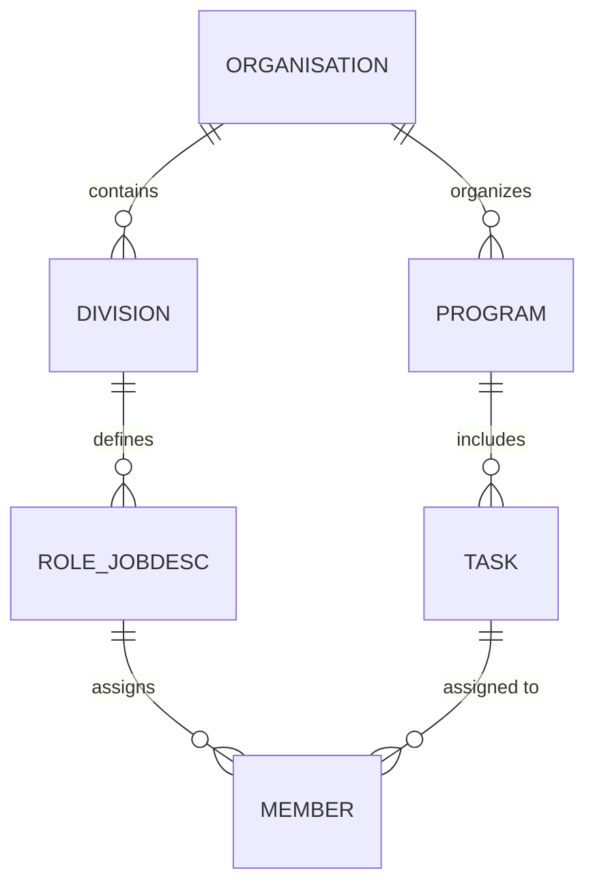

# Himpun — Student Union & Campus Organisation ERP

**Himpun** is an ERP platform built for student unions (*Himpunan Mahasiswa*), student councils, mentoring departments, and campus committees. It streamlines the management of organizations, divisions, job descriptions (jobdescs), committee members, and work programs (Proker / tasks).

---

## 🏛️ Domain Architecture



- **Phase 1**: Student Union **IMT** (Faculty/Major Student Union).
- **Phase 2**: Multi-tenant expansion across multiple student unions, boards, and campus organizations.

---

## 🛠️ Stack & Requirements

- **PHP**: 8.4+ (Laravel Herd recommended)
- **Framework**: Laravel 13.x
- **Database**: SQLite (default local) / MySQL (production)
- **Frontend**: Blade + Tailwind CSS 4

---

## 🚀 Getting Started

```bash
# Set PATH to Herd PHP & Composer (macOS)
export PATH="/Users/seantandjaja/Library/Application Support/Herd/bin:$PATH"

# Install dependencies
composer install
npm install

# Environment setup
cp .env.example .env
php artisan key:generate
php artisan migrate

# Run development server
php artisan serve
# or run with Vite
npm run dev
```


Boost provides your agent 15+ tools and skills that help agents build Laravel applications while following best practices.

## Contributing

Thank you for considering contributing to the Laravel framework! The contribution guide can be found in the [Laravel documentation](https://laravel.com/docs/contributions).

## Code of Conduct

In order to ensure that the Laravel community is welcoming to all, please review and abide by the [Code of Conduct](https://laravel.com/docs/contributions#code-of-conduct).

## Security Vulnerabilities

If you discover a security vulnerability within Laravel, please send an e-mail to Taylor Otwell via [taylor@laravel.com](mailto:taylor@laravel.com). All security vulnerabilities will be promptly addressed.

## License

The Laravel framework is open-sourced software licensed under the [MIT license](https://opensource.org/licenses/MIT).
