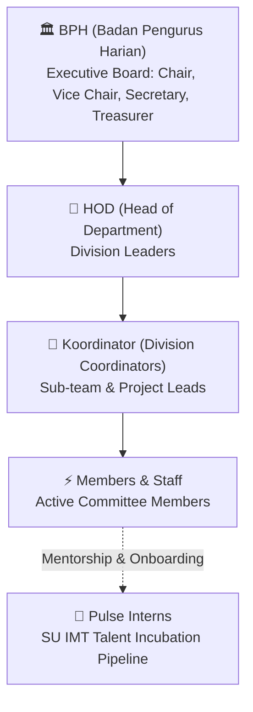
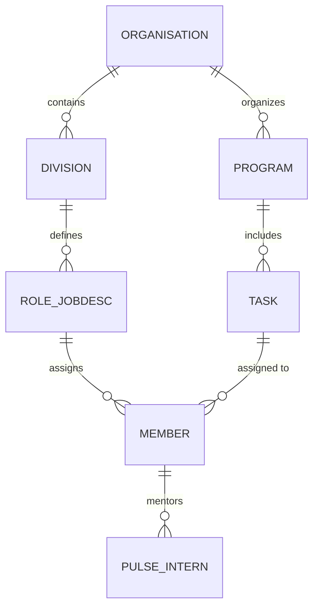

# 🏛️ Himpun — Student Union & Campus Organisation ERP

[](https://laravel.com)
[](https://php.net)
[](https://tailwindcss.com)
[](LICENSE)
[](https://github.com/Sean-230/Himpun-Cloudcom)

**Himpun** (derived from *Himpunan* / *menghimpun*) is a specialized ERP platform purpose-built for university student unions (*Himpunan Mahasiswa*), student councils, mentoring boards, and student activity units (UKMs). 

It bridges the gap between chaotic spreadsheets and rigid corporate ERPs by modeling how student-led committees actually operate: real-world departmental hierarchies, committee roles, task deliverables, and talent incubation pipelines.

---

## 👥 How the Organization Works

Student organizations operate on a hybrid committee structure with multi-tier leadership and specialized operational divisions.

### 1. Hierarchy & Leadership Tiers



- **BPH (Badan Pengurus Harian)**: The core executive leadership (Ketua Himpunan, Wakil, Sekretaris, Bendahara) steering overall organizational direction and accountability.
- **HOD (Head of Department)**: Division directors overseeing divisional strategy, quarterly KPIs, and cross-functional alignment.
- **Koordinator**: Field coordinators driving specific sub-teams, programs, and deliverables.
- **Members / Staff**: Core committee members executing operational job descriptions (jobdescs) and tasks.
- **Pulse Program**: An exclusive internship and talent pipeline for Student Union IMT, introducing junior student cohorts to organizational culture, committee responsibilities, and hands-on event execution before full induction.

---

### 2. Active Divisions (SU IMT Baseline)

Himpun's initial phase models the structure of **Student Union IMT** (Informatika & Information Technology):

| Division | Function & Core Responsibilities |
|---|---|
| 💻 **Tech** | Internal tooling, web development, digital platforms, IT infrastructure, and technical execution. |
| 🎨 **PDD Design** | Visual branding, social media assets, graphic design guidelines, UI/UX, and creative assets. |
| 📸 **PDD Dokum** | Photography, aftermovie videography, media documentation, and archive management. |
| 🎪 **Event** | Concept ideation, rundowns, talent management, guest speakers, and on-the-ground event operations. |
| 🤝 **Social Relation** | External partnerships, public relations, university communications, sponsorship liaisons, and community outreach. |
| 📦 **Properties** | Logistics, equipment procurement, venue bookings, stage setup, and physical inventory management. |

---

## 📊 Team Feature Progress & Roadmap

> [!NOTE]
> **Current Status**: Project scaffolded on Laravel 13 & PHP 8.4. Core domain modeling and initial migrations are currently in planning.

| Module / Feature Area | Target Scope | Status | Progress |
|---|---|:---:|:---:|
| **Foundation & Architecture** | Laravel 13, SQLite/MySQL DB setup, Git repo & CI/CD pipeline | 🟡 In Progress | 40% |
| **Authentication & RBAC** | Multi-role auth (BPH, HOD, Koordinator, Staff, Pulse Intern) | ⚪ Planned | 0% |
| **Organization & Department Core** | Multi-tenant orgs, division management, and jobdesc dictionaries | ⚪ Planned | 0% |
| **Member Directory & Hierarchy** | Student profiles, NIM, line-of-reporting tree, contact directory | ⚪ Planned | 0% |
| **Work Programs (Proker) & Tasks** | Event roadmaps, milestone tracking, task kanban, budget logs | ⚪ Planned | 0% |
| **Pulse Internship Tracker** | Intern task evaluation, attendance, mentor pairing & performance score | ⚪ Planned | 0% |
| **Document & Inventory Hub** | LPJ (Laporan Pertanggungjawaban), Proposal uploads & Properties asset tracking | ⚪ Planned | 0% |

---

## 🏛️ Domain Architecture



- **Phase 1**: Focused deployment for Student Union **IMT** (6 active divisions + Pulse internship).
- **Phase 2**: Multi-tenant support across Student Councils, Mentoring Departments, and UKMs.

---

## 🛠️ Stack & Tooling

- **Backend**: [Laravel 13.x](https://laravel.com)
- **Runtime**: PHP 8.4 (via [Laravel Herd](https://herd.laravel.com))
- **Database**: SQLite (Local Dev) / MySQL (Cloud Production)
- **Styling**: [Tailwind CSS v4](https://tailwindcss.com) + Blade UI
- **Deployment**: CloudPanel / Automated Git webhook & FTP deployment

---

## 🚀 Local Development Setup

### 1. Prerequisites
Ensure PHP 8.4 and Composer are available in your shell environment:

```bash
# Add Laravel Herd binaries to PATH (macOS)
export PATH="/Users/seantandjaja/Library/Application Support/Herd/bin:$PATH"

php -v
composer -V
```

### 2. Installation & Run

```bash
# 1. Clone repository
git clone https://github.com/Sean-230/Himpun-Cloudcom.git
cd Himpun-Cloudcom

# 2. Install dependencies
composer install
npm install

# 3. Setup environment & database
cp .env.example .env
php artisan key:generate
touch database/database.sqlite
php artisan migrate

# 4. Start local development server
php artisan serve
# or run frontend hot-reload
npm run dev
```

---

## 📄 License
This project is open-source under the [MIT License](LICENSE).
